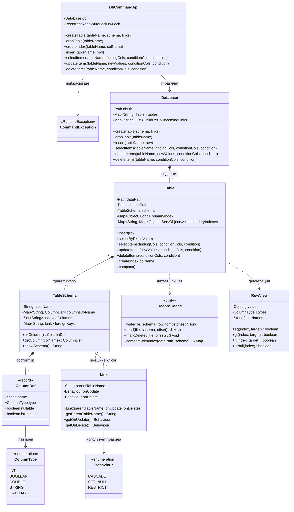
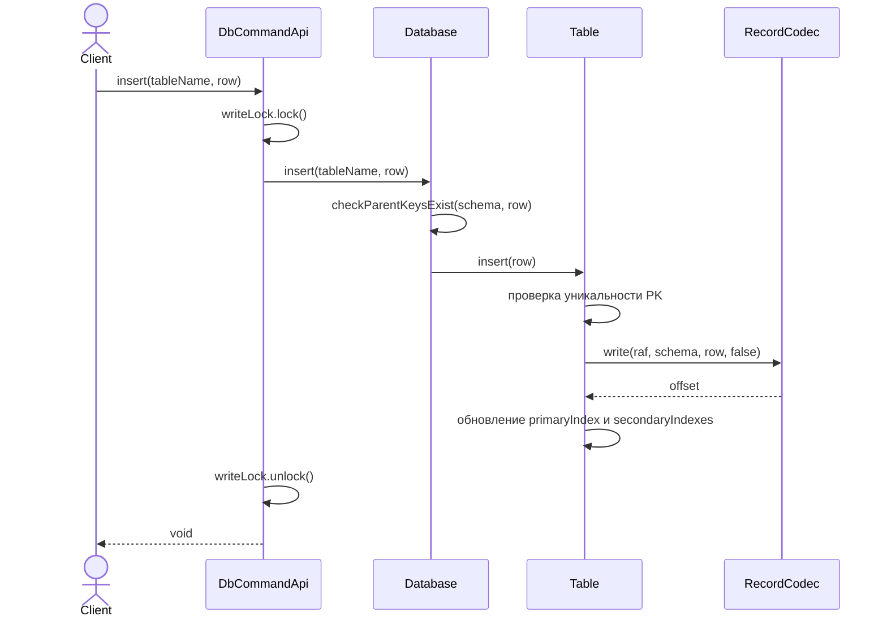
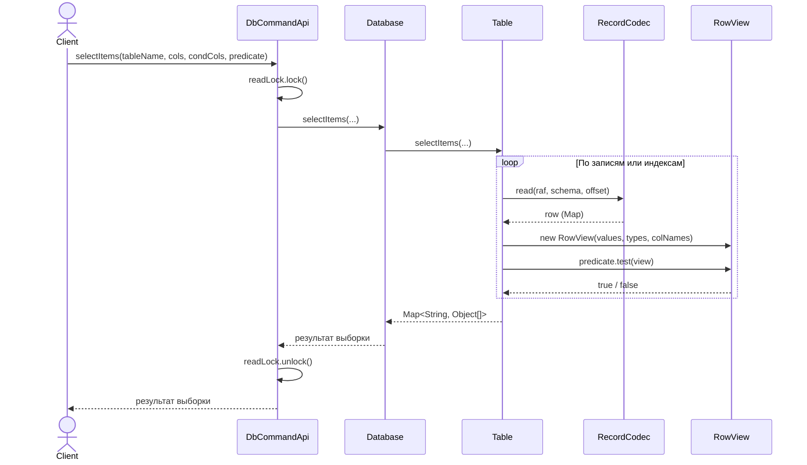
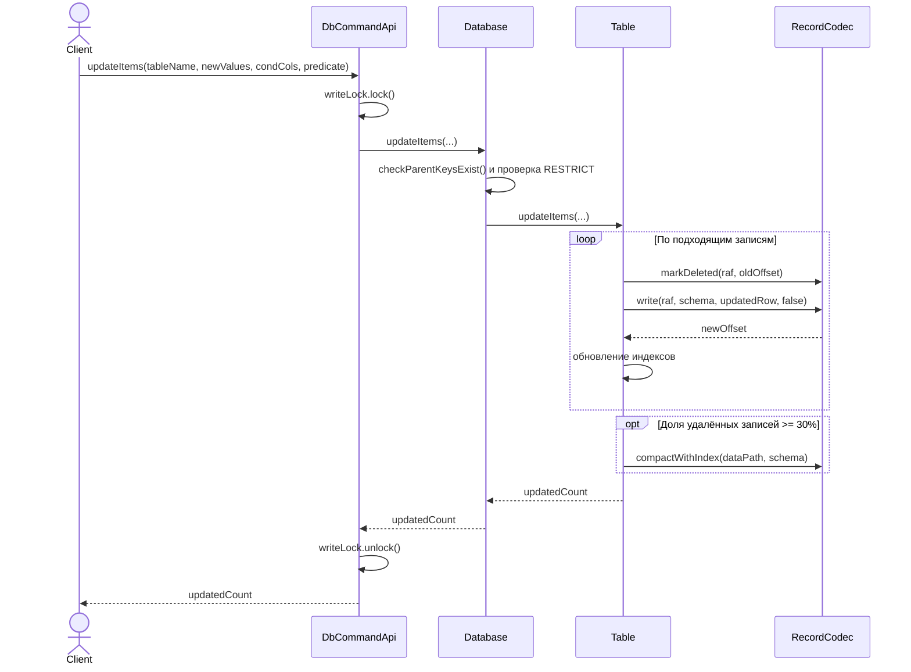
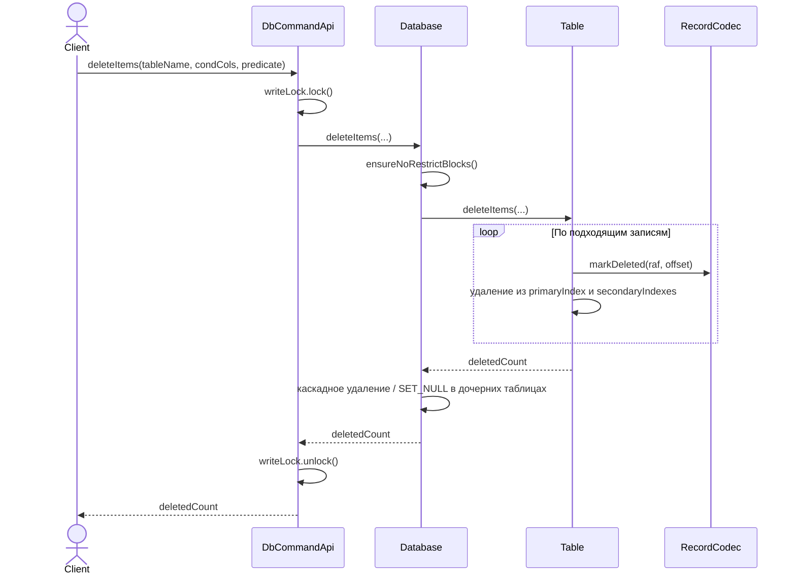

# СУБД с бинарным хранением на диске

Простая реляционная СУБД на Java с бинарным хранением таблиц,
вторичными индексами в памяти, поддержкой внешних ключей (`CASCADE` /
`SET_NULL` / `RESTRICT`) и SQL-подобным языком запросов.

## Состав команды и зоны ответственности

| Участник | ФИО | Зона ответственности | Модули |
|---|---|---|---|
| **Ffgags13** | Веселов Б. | Ядро СУБД | `main.core` целиком: `Database`, `Table`, `TableSchema`, `ColumnDef`, `ColumnType`, `Link`, `RecordCodec`, `RowView`, `domainExceptions` |
| **gkgoldberg** | Гольдберг Г. | UI и валидация ввода | `Main`, `main.ui` (`SqlExecutor`, `QueryResult`, `TablePrinter`); `Raw string(len > 5, stripped())` → Parser, `Exceptions***` → UI; `UI → Command → Core` (позиционный `insert`) |
| **skare** | Поляков Н. | Парсер, слой команд и индексы | `main.query` (Lexer, Parser, Ast, Token, TokenType, ParseException); `main.command` (`DbCommandApi`, `CommandException`, `CommandExecutor`, `ExpressionCompiler`); индексы (использование `primaryIndex`/`secondaryIndexes` в `Table.selectItems`, `createIndex`, авто-индексы по FK) |

### Ffgags13 — Веселов Б. — ядро СУБД

- **`main.core.Database`** — жизненный цикл таблиц, граф FK, ссылочная целостность (`CASCADE` / `SET_NULL` / `RESTRICT`).
- **`main.core.Table`** — append-only хранение в `*.dat` с `tombstone`, авто-компактификация, `primaryIndex` / `secondaryIndexes`.
- **`main.core.TableSchema`** — столбцы, индексы, FK, `showSchema` / `showShortSchema`.
- **`main.core.ColumnDef`, `ColumnType`, `Link`, `RecordCodec`, `RowView`** — типы, сериализация, сравнение, представление строки.
- **`main.core.domainExceptions.*`** — иерархия исключений ядра.

### gkgoldberg — Гольдберг Г. — UI и валидация ввода

- **`Main`** — меню, SQL-консоль, интерактивный режим.
- **`main.ui`** — `SqlExecutor` (Parser → CommandExecutor → `QueryResult`), `QueryResult`, `TablePrinter`.
- **Валидация** — `Raw string(len > 5, stripped())` до парсера, `parseValue` с try/catch, отображение `Exceptions***`.
- **`UI → Command → Core`** — прямой вызов `DbCommandApi.insert(string, Object[])`.

### skare — Поляков Н. — парсер, команды, индексы

- **`main.query`** — `Lexer`, `Parser`, `Ast` (`sealed`), `Token`, `TokenType`, `ParseException`.
- **`main.command`** — `DbCommandApi` (RW-lock, обёртка ошибок в `CommandException`), `CommandException`, `CommandExecutor` (Ast → API), `ExpressionCompiler` (Ast.Expr → `Predicate<RowView>`).
- **Индексы** — `Table.createIndex`, использование `primaryIndex` / `secondaryIndexes` в `Table.selectItems`, авто-построение индексов по FK-столбцам.
- **Интеграция Parser → Command → Core** — сквозные тесты.
## Архитектура
UI (Main, SqlExecutor, TablePrinter, QueryResult)
│
│ Raw string(len > 5, stripped())
▼
Parser (Lexer → Parser → Ast) ──ParseException──► UI
│
│ Ast.Statement
▼
Command (CommandExecutor, ExpressionCompiler, DbCommandApi, CommandException)
│
│ DatabaseException / CommandException
▼
Core (Database, Table, TableSchema, ColumnDef, ColumnType, Link,
RecordCodec, RowView, domainExceptions)
│
▼
Диск: <table>.dat (бинарные записи) + <table>.schema.json
## Диаграмма классов

## Диаграммы последовательностей

### 1. Вставка записи (`INSERT`)
Показывает захват блокировки записи, проверку внешнего ключа в родительской таблице, запись байтов в `.dat` и обновление индексов.

---

### 2. Выборка записей (`SELECT`)
Показывает разделяемую блокировку чтения (`readLock`), чтение строк с диска и фильтрацию через `RowView`.

---

### 3. Обновление записей (`UPDATE`)
Показывает append-only обновление: старая версия помечается как `tombstone`, новая дописывается в конец файла, а при необходимости запускается `compact()`.

---

### 4. Удаление записей (`DELETE`)
Показывает проверку ограничений внешних ключей (`RESTRICT`), логическое удаление записей (`tombstone = 1`) и каскадную обработку зависимых таблиц (`CASCADE` / `SET_NULL`).

